# UI/UX redesign screenshot gallery

Current corrective review: [model workspace, photographic surface, before/after and repaired animations](model-workspace/README.md). The original 73 V1 captures below remain as the earlier review record; CI regenerates the full state gallery against each head.

All data and photos are synthetic. Captures use the isolated loopback developer fixture loader. These are layout evidence, not evidence of human predictive accuracy. Browser: 155.0.4283.45.

Baseline and comparison: [before screenshots](before/) · [baseline verification](baseline.json) · [performance](performance-comparison.json) · [UI checks](ui-smoke.json) · [visual review](REVIEW.md).

## brand-new

[320 px](brand-new-320.png) · [390 px](brand-new-390.png) · [1400 px](brand-new-1400.png)

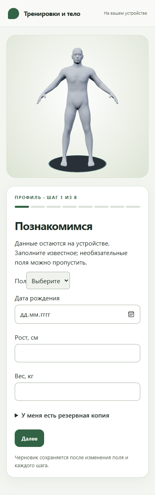

## avatar-draft

[320 px](avatar-draft-320.png) · [390 px](avatar-draft-390.png) · [1400 px](avatar-draft-1400.png)

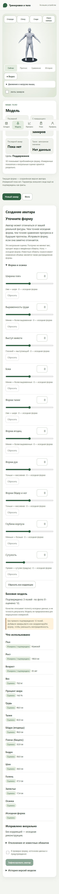

## model-current

[390 px](model-current-390.png) · [1400 px](model-current-1400.png)

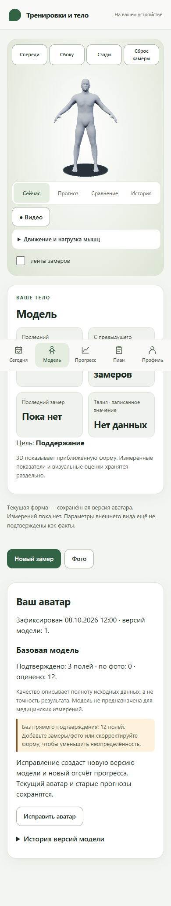

## today-empty

[320 px](today-empty-320.png) · [390 px](today-empty-390.png) · [1400 px](today-empty-1400.png)

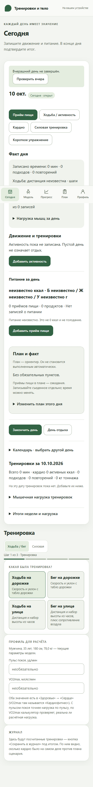

## nutrition-editor

[320 px](nutrition-editor-320.png) · [390 px](nutrition-editor-390.png) · [1400 px](nutrition-editor-1400.png)

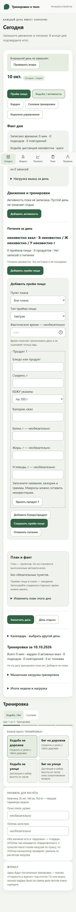

## close-day

[320 px](close-day-320.png) · [390 px](close-day-390.png) · [1400 px](close-day-1400.png)

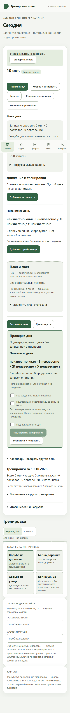

## hypothesis-insufficient

[390 px](hypothesis-insufficient-390.png) · [1400 px](hypothesis-insufficient-1400.png)

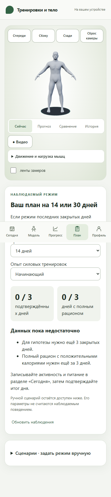

## profile-privacy-data

[390 px](profile-privacy-data-390.png) · [1400 px](profile-privacy-data-1400.png)

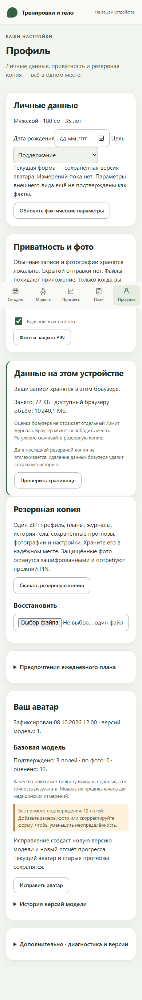

## today-populated

[390 px](today-populated-390.png) · [1400 px](today-populated-1400.png)

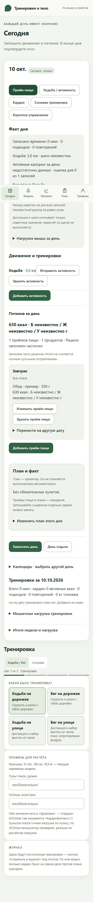

## hypothesis-preview

[390 px](hypothesis-preview-390.png) · [1400 px](hypothesis-preview-1400.png)

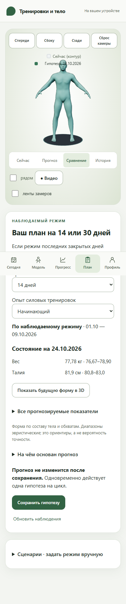

## nutrition-partial

[390 px](nutrition-partial-390.png) · [1400 px](nutrition-partial-1400.png)

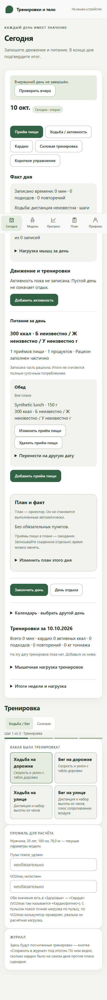

## nutrition-complete

[390 px](nutrition-complete-390.png) · [1400 px](nutrition-complete-1400.png)

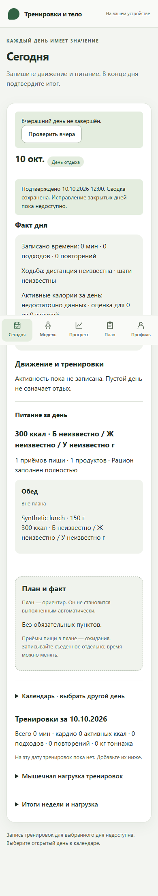

## hypothesis-preliminary

[390 px](hypothesis-preliminary-390.png) · [1400 px](hypothesis-preliminary-1400.png)

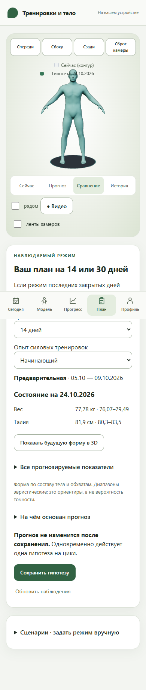

## hypothesis-preliminary-issued

[390 px](hypothesis-preliminary-issued-390.png) · [1400 px](hypothesis-preliminary-issued-1400.png)

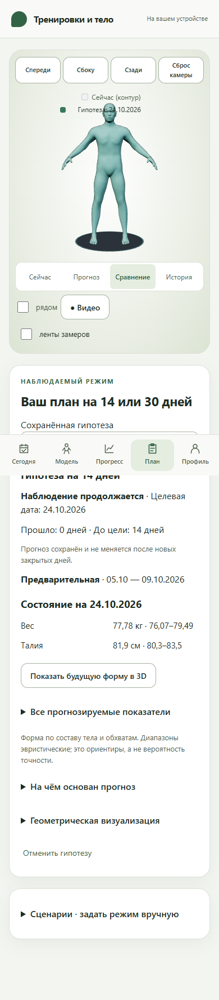

## hypothesis-active-14d

[390 px](hypothesis-active-14d-390.png) · [1400 px](hypothesis-active-14d-1400.png)

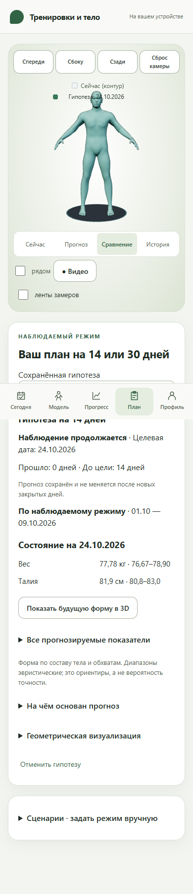

## hypothesis-awaiting-outcome

[320 px](hypothesis-awaiting-outcome-320.png) · [390 px](hypothesis-awaiting-outcome-390.png) · [1400 px](hypothesis-awaiting-outcome-1400.png)

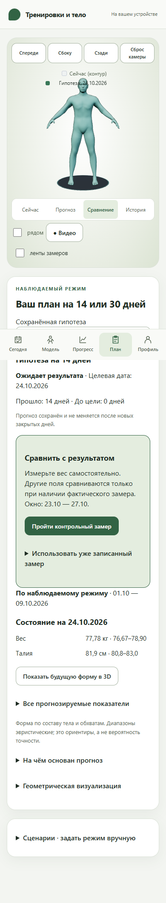

## hypothesis-evaluated

[320 px](hypothesis-evaluated-320.png) · [390 px](hypothesis-evaluated-390.png) · [1400 px](hypothesis-evaluated-1400.png)

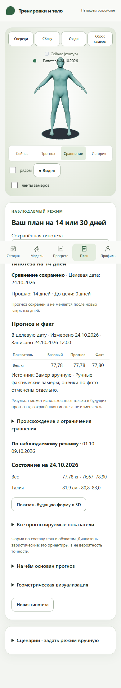

## progress

[390 px](progress-390.png) · [1400 px](progress-1400.png)

## hypothesis-expired

[390 px](hypothesis-expired-390.png) · [1400 px](hypothesis-expired-1400.png)

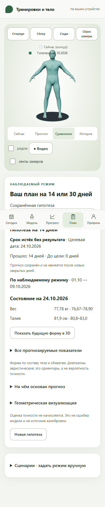

## checkin-form

[320 px](checkin-form-320.png) · [390 px](checkin-form-390.png) · [1400 px](checkin-form-1400.png)

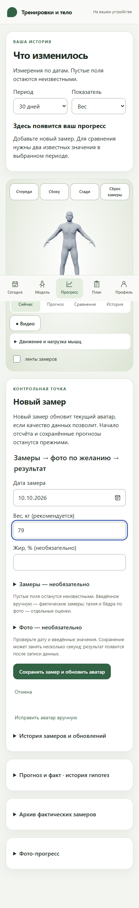

## checkin-good-photo-result

[390 px](checkin-good-photo-result-390.png) · [1400 px](checkin-good-photo-result-1400.png)

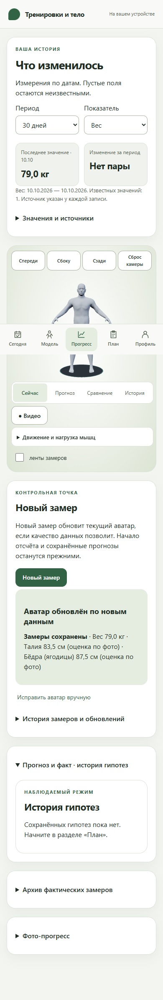

## checkin-optional

[320 px](checkin-optional-320.png) · [390 px](checkin-optional-390.png) · [1400 px](checkin-optional-1400.png)

## checkin-bad-photo-result

[390 px](checkin-bad-photo-result-390.png) · [1400 px](checkin-bad-photo-result-1400.png)

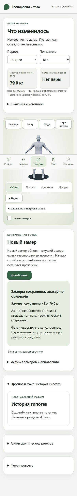

## storage-warning

[390 px](storage-warning-390.png) · [1400 px](storage-warning-1400.png)

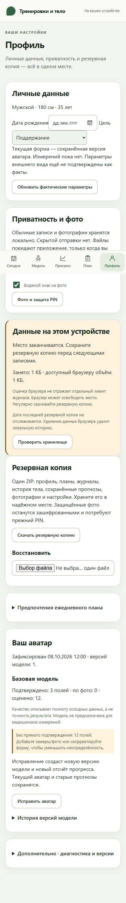

## geometry-eligible

[390 px](geometry-eligible-390.png) · [1400 px](geometry-eligible-1400.png)

## geometry-unsupported

[390 px](geometry-unsupported-390.png) · [1400 px](geometry-unsupported-1400.png)

## progress-large-history

[390 px](progress-large-history-390.png) · [1400 px](progress-large-history-1400.png)

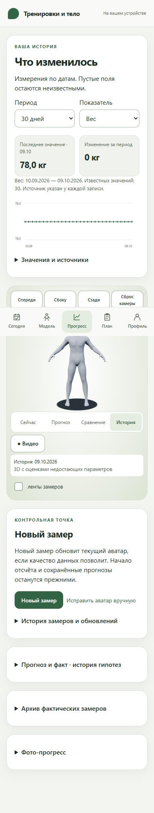

## model-compare

[390 px](model-compare-390.png) · [1400 px](model-compare-1400.png)

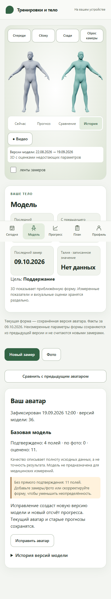

## recovery-corrupt

[320 px](recovery-corrupt-320.png) · [390 px](recovery-corrupt-390.png) · [1400 px](recovery-corrupt-1400.png)

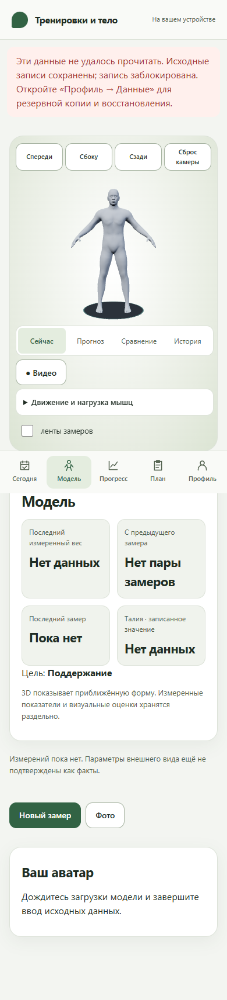

## offline

[390 px](offline-390.png) · [1400 px](offline-1400.png)

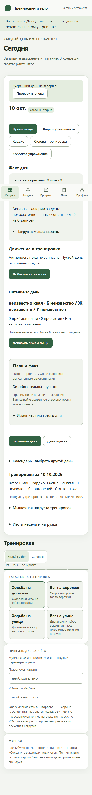

## webgl-unavailable

[320 px](webgl-unavailable-320.png) · [390 px](webgl-unavailable-390.png) · [1400 px](webgl-unavailable-1400.png)

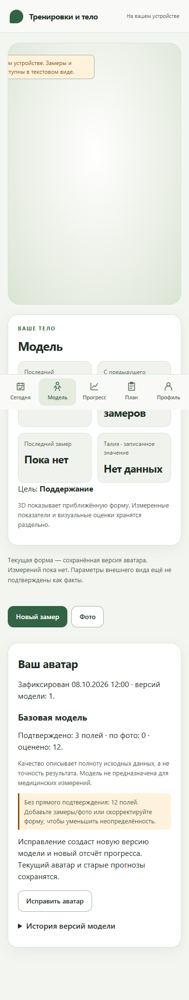
