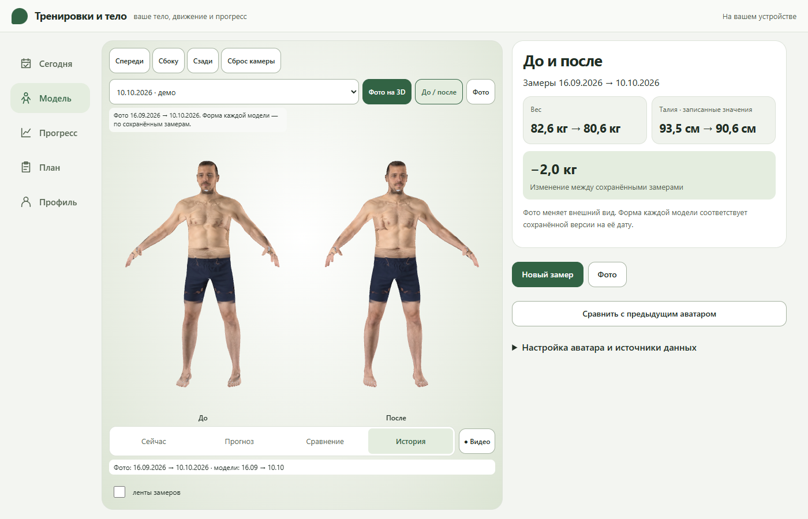

# Model workspace review · 2026-10-14

All six source photographs depict a fictional adult and were generated for the developer demo. They are labelled **ДЕМО · ИИ**, remain `DeveloperFixture` inputs, and are not factual reconstruction or forecast evidence. The screenshots below use the actual local pose detector and viewer; no external photo service is involved.

| State | Evidence |
|---|---|
| Photo surface | [Front](texture-front.png), [side](texture-side.png), [back](texture-back.png) |
| Two dates, independent photo textures | [Before / after](photo-before-after.png) |
| Earlier photo and saved body | [16 September](texture-old.png) |
| Observed forecast alongside current form | [Plan](compact-plan.png) |
| Window layout | [320](compact-320.png), [390](compact-390.png), [768](compact-768.png), [1024](compact-1024.png), [1400](compact-1400.png) |
| Exercise poses | [Squat](squat.png), [bench press](bench-press.png), [curl](biceps-curl.png), [pulldown](lat-pulldown.png), [hinge](romanian-deadlift.png) |

[Browser regression results](regression.json) · [Photo retention/domain/layout checks](texture-checks.json). Behavioral tests keep assertions about durable saves, frozen endpoints, independent skeletons, privacy, backup/recovery and source provenance. The model-workspace CI test uses a deterministic detector fixture to isolate rendering/resource behavior; it does not replace the actual-detector visual review above.

The photo surface is an approximate projection. Seams, stretched texture and occluded details remain possible; clothing/hair are not reconstructed as separate geometry. The forecast uses the recorded appearance on predicted geometry and is not an actual future photo. The display never updates measurements or saved hypotheses.

